<p align="center">
  
</p>

<p align="center">
  <a href="LICENSE"></a>
  
  
  
</p>

<p align="center">
  Chat, send files and get notified, all from a terminal on your phone.<br>
  Built on <a href="https://github.com/tulir/whatsmeow">whatsmeow</a> and the WhatsApp Web multi-device protocol.
</p>

> [!WARNING]
> wacli is an **unofficial** project and is not affiliated with or endorsed by WhatsApp or Meta.
> Automated clients can get an account restricted, so use it for your own personal chats.

## Features

- **Full-screen TUI** with chats, groups, channels and five themes
- **Scriptable CLI** for sending, reading, reacting, editing and downloading, with `--json` output
- **Pairing code login**, so no QR scan is needed
- **Background daemon** that stays connected and sends Termux notifications
- **Encrypted storage**: keys and messages live in one passphrase-protected database

## Install

```bash
pkg update && pkg install golang clang git termux-api
termux-setup-storage        # lets wacli save media to your Downloads folder

git clone https://github.com/bhawan-kavinda/wacli.git && cd wacli
go mod tidy
go build -o $PREFIX/bin/wacli .
```

The first build compiles SQLite and can take a few minutes.
For notifications, also install the **Termux:API** app from F-Droid.

## Quick start

```bash
wacli login 94771234567     # your number with country code, then choose a passphrase
```

Enter the 8-character code in WhatsApp under **Settings → Linked devices → Link a device → Link with phone number instead**.

```bash
wacli daemon start          # unlock once, stay connected
wacli                       # open the TUI
```

Without the daemon, each command asks for your passphrase, does its job and disconnects.

## Commands

```bash
wacli chats                            # list chats
wacli msgs mom -n 30                   # read the last 30 messages
wacli send mom "hello"                 # use - to read text from stdin
wacli send mom "yes" --reply 3EB0A1B2  # reply to a message
wacli sendfile mom ~/pic.jpg "caption"
wacli get mom 3EB0A1B2                 # download media
wacli react mom 3EB0A1B2 👍
wacli read mom                         # mark as read
wacli watch                            # live stream of messages and typing
```

Also available: `contacts`, `groups`, `edit`, `rm`, `presence`, `alias` and `config`. Run `wacli help` for the full list.
`<chat>` can be an alias, a contact or group name (fuzzy), a phone number or a JID.

## TUI keys

| Where | Keys |
| --- | --- |
| List | `j` `k` or `↑` `↓` move, `Enter` open, `1`-`4` or `←` `→` tabs (Chats, Groups, Channels, Unread), `u` unread tab, `c` contacts / new chat, `p` pin ★ / unpin, `d` home dashboard, `q` quit |
| Chat | type and `Enter` send, `PgUp` `PgDn` scroll, `Esc` back |
| Search | `/` searches chats, contacts (even with no history) and message text; `Enter` opens the hit |
| Drafts | unsent text is kept per chat (also after closing wacli); pasted multi-line text stays one message until you press `Enter` |
| Touch | tap a chat, tab or the `+ Contacts` button; swipe to scroll; tap a message to pick it |
| Slash commands | `/r N text` · `/react N 👍` · `/edit N text` · `/del N` · `/get N` · `/file path` · `/theme` · `/help` |

`N` is the message number shown at the start of each line. Ticks: ✓ sent, ✓✓ delivered, blue ✓✓ read.

## Security

Everything is stored in one SQLite database, kept on disk only as `~/.wacli/wacli.db.enc`
(AES-256-GCM, key derived with argon2id from your passphrase).

While wacli runs, a decrypted working copy lives in Termux's private temp directory and is re-encrypted every 2 minutes and on exit.
After a hard kill, a leftover copy in `$TMPDIR/wacli-<uid>/` is re-encrypted on the next start.

**Forget the passphrase and the data is gone.** Run `rm -r ~/.wacli` and log in again.

## Good to know

- Chats are built from messages sent or received while wacli is running. Old WhatsApp history is not imported.
- Media can only be downloaded for messages received while wacli was running.
- Presence (online, last seen) is visible only for contacts who allow it.
- Debug with `WACLI_DEBUG=1 wacli ...`. The daemon log is at `~/.wacli/daemon.log`.

## License

wacli is released under the [Mozilla Public License 2.0](LICENSE).
Modified versions of the covered source files must stay under the same license, and their source must be made available when distributed.

It builds on [whatsmeow](https://github.com/tulir/whatsmeow) (MPL-2.0) and the [Charm](https://charm.sh) terminal libraries.
WhatsApp is a trademark of Meta Platforms, Inc.
